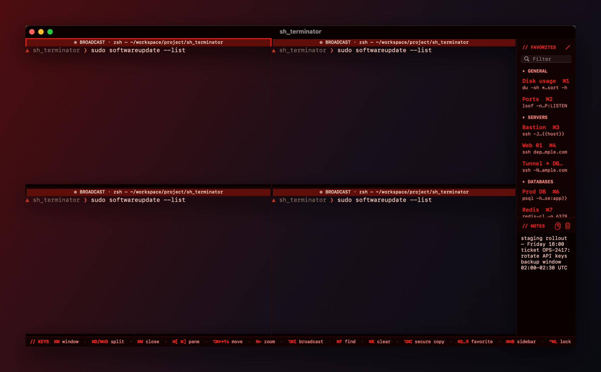
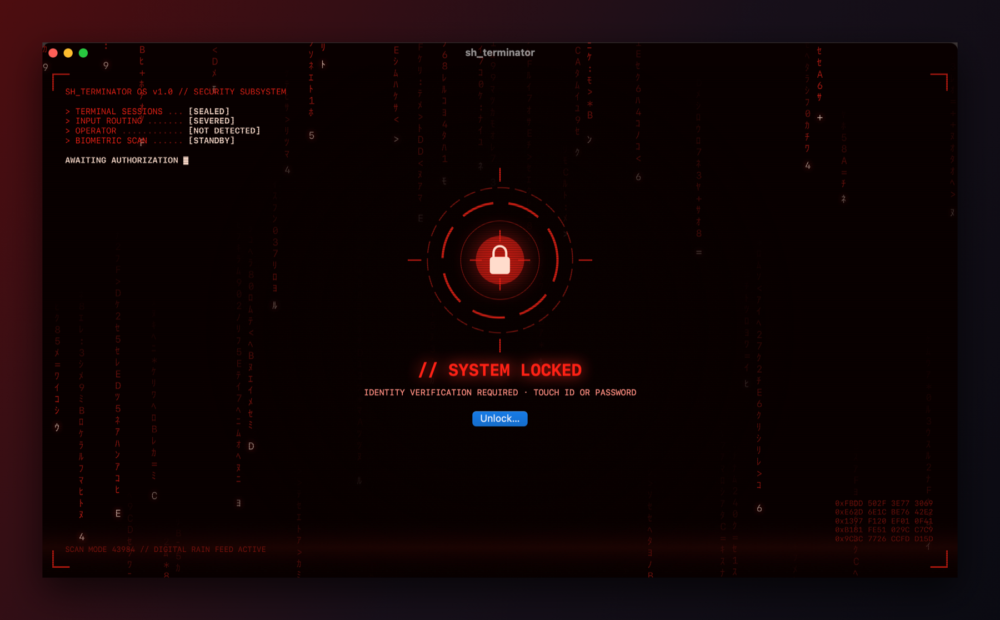

<div align="center">

# sh_terminator

**A native macOS split-pane terminal built to keep passwords, keys and seed phrases safe on screen.**

Panes like iTerm2 or tmux, plus protection a regular terminal doesn't give you: windows hidden from screenshots and screen sharing, a Touch ID lock, paste checks and a clean clipboard.


-blue)


</div>

---

## Contents

- [Highlights](#highlights)
- [Install & run](#install--run)
- [Keyboard shortcuts](#keyboard-shortcuts)
- [Panes](#panes)
- [Broadcast input](#broadcast-input)
- [Favorite commands](#favorite-commands)
- [Notes](#notes)
- [Security](#security)
- [Project layout](#project-layout)
- [Out of scope](#out-of-scope)

## Highlights

| | |
|---|---|
| 🪟 **Split panes** | ⌘D / ⌘⇧D, nested as deep as you like. Drag dividers freely, zoom one pane, move between panes with arrow keys. Windows can start from 2/4/6/8/10-pane templates. |
| 🙈 **Hidden from capture** | Windows are excluded from screenshots, screen recording and screen sharing (Zoom, Meet, Slack, QuickTime). |
| 🔒 **Lock** | ⌃⌘L, an idle timer, or Mac sleep/screen lock hides every window. Touch ID or your password unlocks it. |
| 📋 **Safe paste** | ⌘V checks multi-line and suspicious pastes before they can run. Copy & Clear wipes the clipboard after 20 seconds. |
| 📡 **Broadcast** | Type into every pane of a window at once. Password prompts are never echoed into another pane's shell. |
| ⭐ **Favorites** | Saved commands grouped into categories, with `{{placeholders}}`, inserted with ⌘1…⌘9 or from the sidebar, but never run for you. |
| 📝 **Notes** | A scratch pad next to the favorites. Copied text is marked as a secret so clipboard managers skip it. |
| 🧱 **Small surface** | No networking, one pinned dependency, Hardened Runtime, no core dumps, files saved with mode `0600`. |

## Install & run

You only need the Xcode Command Line Tools; the full Xcode.app isn't required.

```sh
./Scripts/build-app.sh      # swift build -c release, package as .app, codesign
open dist/SHTerminator.app
```

For development without rebuilding the `.app`:

```sh
swift run
```

Run the tests and check the claims in [SECURITY.md](SECURITY.md) (`build-app.sh` runs the audit itself after building):

```sh
swift test
./Scripts/audit.sh
```

> [!NOTE]
> By default the app is signed ad-hoc, which only suits your own Mac. To sign with a real identity, set `SIGN_IDENTITY`; see the comments in `Scripts/build-app.sh` and SECURITY.md §6.

## Keyboard shortcuts

<table>
<tr><th>Windows & panes</th><th></th><th>Text & tools</th><th></th></tr>
<tr><td>New window</td><td><kbd>⌘N</kbd></td><td>Find / next / previous</td><td><kbd>⌘F</kbd> <kbd>⌘G</kbd> <kbd>⌘⇧G</kbd></td></tr>
<tr><td>Split left | right</td><td><kbd>⌘D</kbd></td><td>Clear scrollback</td><td><kbd>⌘K</kbd></td></tr>
<tr><td>Split top / bottom</td><td><kbd>⌘⇧D</kbd></td><td>Bigger / smaller / default font</td><td><kbd>⌘+</kbd> <kbd>⌘−</kbd> <kbd>⌘0</kbd></td></tr>
<tr><td>Close pane</td><td><kbd>⌘W</kbd></td><td>Copy & clear clipboard after 20 s</td><td><kbd>⌥⌘C</kbd></td></tr>
<tr><td>Close window</td><td><kbd>⌘⇧W</kbd></td><td>Lock all windows</td><td><kbd>⌃⌘L</kbd></td></tr>
<tr><td>Next / previous pane</td><td><kbd>⌘]</kbd> <kbd>⌘[</kbd></td><td>Insert favorite 1…9</td><td><kbd>⌘1</kbd> … <kbd>⌘9</kbd></td></tr>
<tr><td>Pane left / right / up / down</td><td><kbd>⌥⌘←</kbd> <kbd>⌥⌘→</kbd> <kbd>⌥⌘↑</kbd> <kbd>⌥⌘↓</kbd></td><td>Add selection to favorites</td><td><kbd>⌘⇧S</kbd></td></tr>
<tr><td>Zoom pane (toggle)</td><td><kbd>⌘↩</kbd></td><td>Manage favorites</td><td><kbd>⌘⇧F</kbd></td></tr>
<tr><td>Broadcast input (toggle)</td><td><kbd>⌥⌘I</kbd></td><td>Show / hide sidebar</td><td><kbd>⌘⇧B</kbd></td></tr>
</table>

Templates are under **File → New Window From Template** (2, 4, 6, 8 or 10 panes). Clicking a pane also focuses it.

## Panes

- Each pane has a slim header showing the title the program set, or **program — directory** (for example `ssh — ~/work`). The header text only goes into the window title if you turn on **Show Pane Title in Window Title**, which is off by default (SECURITY.md §17).
- A new pane (⌘D / ⌘⇧D) opens in the current directory of the pane you split.
- **Close confirmation:** if something other than the shell is running in a pane (`ssh`, `vim`, `top`…), ⌘W, ⌘⇧W and ⌘Q ask first.
- **Checked paste (⌘V):** see SECURITY.md §15.

## Broadcast input



Turn it on with <kbd>⌥⌘I</kbd>, and whatever you type or paste into one pane goes to every pane in that window. While it's on, the pane headers turn red and say **BROADCAST**.

- Each pane checks a paste against **its own** program, not the program in the pane you pasted into.
- A password you type or paste at a no-echo prompt only goes to panes that are also at a no-echo prompt. One `sudo` password can unlock every pane, but it never appears in plain text at another pane's shell prompt or in its history (SECURITY.md §16).

## Favorite commands


The **Favorites** menu holds commands you use often, like connecting to a remote database. Choosing one, or pressing <kbd>⌘1</kbd>…<kbd>⌘9</kbd>, **inserts** it into the active pane but doesn't run it. You press Return yourself, so you can edit it first.

- **Categories:** group favorites as you like (*Servers*, *Databases*, *Kubernetes*…). Everything starts in **Uncategorized**, a built-in group you can rename but not delete. In the manager you can add a category with **+**, rename it by double-clicking, reorder categories by dragging, and move a favorite with its **Category** popup or by dragging it onto a category. Deleting a category keeps its favorites by moving them to the built-in group. Once there's at least one category, the sidebar and the Favorites menu show a heading for each, and <kbd>⌘1</kbd>…<kbd>⌘9</kbd> follow that order.
- **Sidebar:** each window has one scrollable list on the right, however many panes it has. Click a command to insert it into the focused pane (the one with the highlighted border). <kbd>⌘⇧B</kbd> shows or hides it; the pencil icon opens the manager.
- **Manage Favorites… (<kbd>⌘⇧F</kbd>):** categories on the left, the selected category's favorites on the right. Add or remove entries, double-click to edit, drag to reorder. **Insert into Terminal** (<kbd>⌘↩</kbd>) inserts the selected command.
- **Add Selection to Favorites (<kbd>⌘⇧S</kbd>):** select a command in the terminal to save it as a new entry.
- **Placeholders:** write `{{name}}` or `{{name:default}}` in a command, for example
  ```
  psql -h {{host:db.internal}} -U {{user}}
  ```
  When you insert it, a form asks for each value, and the filled-in command goes to the terminal.
- **Filter:** the search field above the list (shown once there are two or more entries) matches names and command text.

Stored in `~/Library/Application Support/SHTerminator/favorites.json` with mode `0600`. Don't put passwords in a command; see SECURITY.md §11.

## Notes

Below the favorites in the sidebar is a **Notes** box: a plain text field for pasting something now and copying it or deleting it later.

- The header buttons **copy everything** and **clear** (undo with <kbd>⌘Z</kbd>).
- Copied text is marked as a secret: clipboard managers don't record it and it isn't synced to your other devices.
- Drag the divider between favorites and notes to change its height.
- The text is shared by all windows and kept across restarts in `~/Library/Application Support/SHTerminator/notes.txt` (`0600`, deleted when you clear it). To keep notes in memory only, turn off **Keep Notes Across Restarts** (SECURITY.md §12).

## Security



Settings in the **sh_terminator** app menu:

| Setting | Default | What it does |
|---|---|---|
| **Secure Keyboard Entry** | on | Other processes' event taps (keyloggers) see nothing you type here (§13). |
| **Lock Now** <kbd>⌃⌘L</kbd> / **Auto-Lock** | — | Hides all windows, now or after N idle minutes. Unlock with Touch ID or your password (§14). |
| **Lock When Mac Sleeps or Screen Locks** | on | Also locks on sleep, screen lock and user switching. |
| **Hide Windows When in Background** | off | Covers windows while another app is active. |
| **Show Pane Title in Window Title** | off | The window title is visible outside the window (Dock, Mission Control, Accessibility). |
| **Keep Notes Across Restarts** | on | When off, notes live in memory only and the file is deleted (§12). |

The full threat model, how to check each protection, and the risks that remain are in **[SECURITY.md](SECURITY.md)** (in Russian).

## Project layout

```
Sources/SHTerminator/
  main.swift                       NSApplication entry point
  AppDelegate.swift                menus, open windows
  PTY/PaneSession.swift            one shell process on its own pty = one pane
  PTY/TerminalPaneView.swift       SwiftTerm view + paste checks + broadcast input hook
  Layout/PaneNode.swift            layout tree (same shape as tmux/iTerm2)
  Layout/SplitPaneController.swift tree → live NSSplitView hierarchy, navigation, broadcast
  Layout/PaneContainerView.swift   pane = header + terminal
  Layout/PaneTemplates.swift       ready-made 2/4/6/8/10-pane layouts
  UI/                              window, menus, equal-split NSSplitView
  Favorites/                       store, menu, manager window, sidebar, placeholders
  Notes/                           notes box and its store
  Settings/AppSettings.swift       the few settings (UserDefaults)
  Security/SecurityHardening.swift process, window, Secure Input, clipboard, 0600 files
  Security/PrivacyLock.swift       window lock
  Security/PastePolicy.swift       paste check rules
  Security/HostRequestFilter.swift what a program in a pane may ask the terminal for
  Security/HostOutputFilter.swift  neutralises screen-read and local-file requests in output
Tests/SHTerminatorTests/           swift test (Swift Testing)
Scripts/audit.sh                   mechanical check of SECURITY.md claims
Scripts/make-icon.swift            the app icon, drawn in code (./Scripts/make-icon.sh)
```

The only external dependency is [SwiftTerm](https://github.com/migueldeicaza/SwiftTerm), pinned to an exact version in `Package.swift` / `Package.resolved`. SECURITY.md explains why.

## Out of scope

A Preferences window (theme, font, default shell), tabs, saving and restoring a window's *layout* (without pane contents), and exporting a session log on request. None of these are implemented; they would only be added if someone explicitly asks for them.
